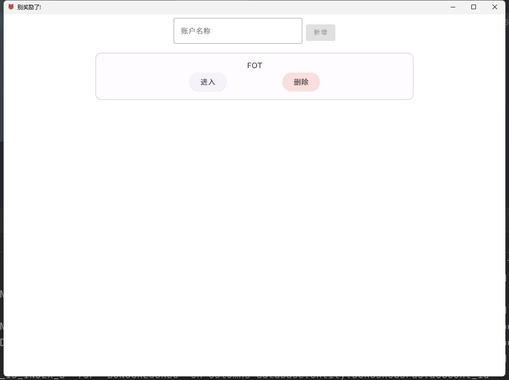
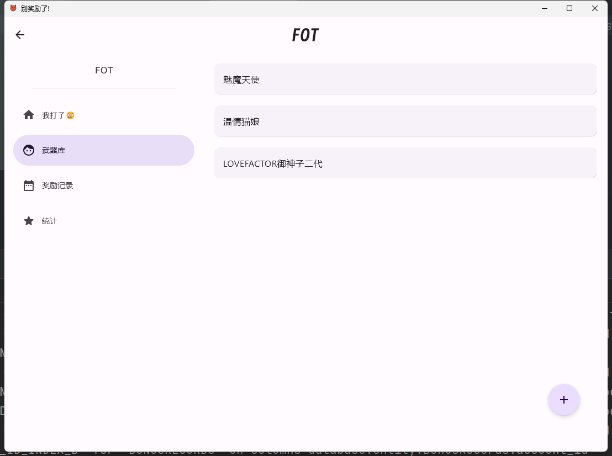
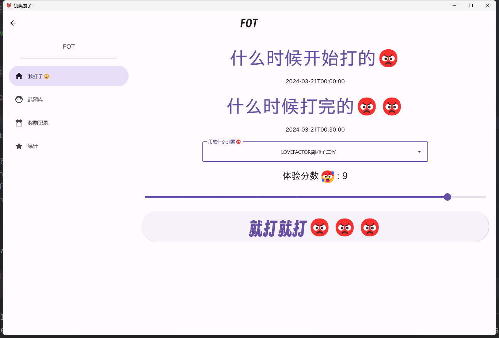
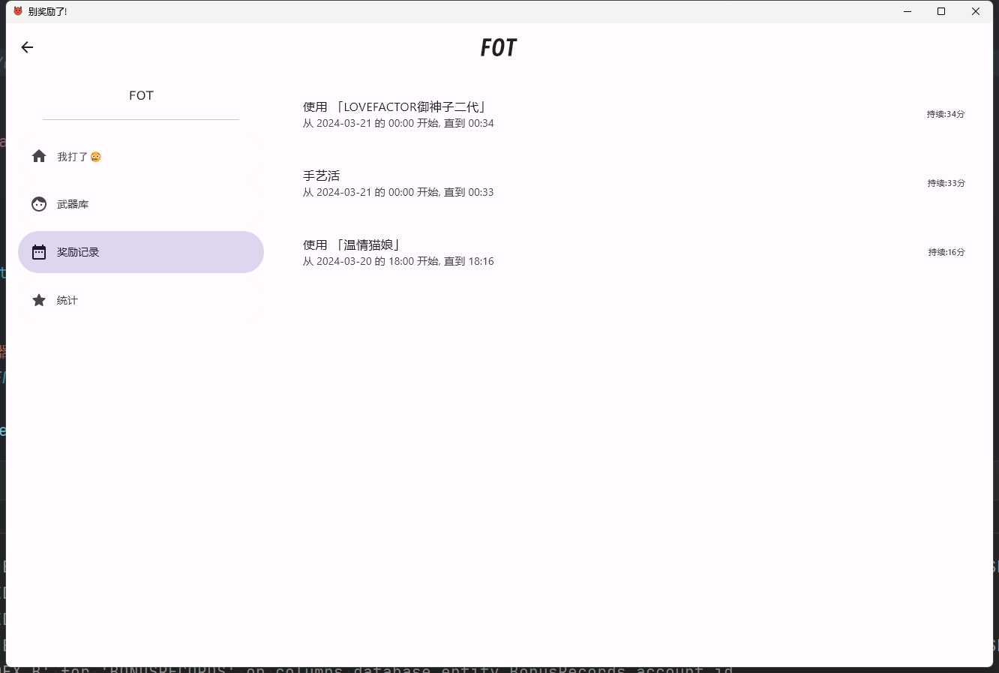
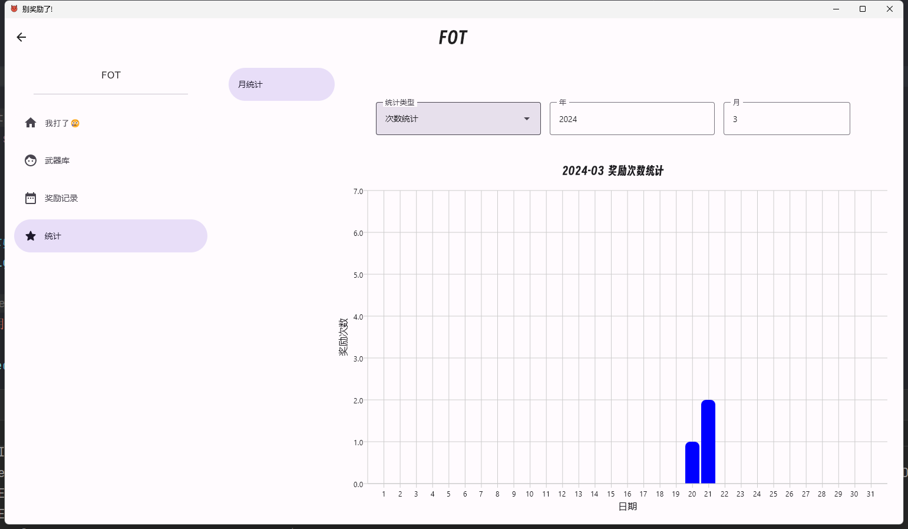
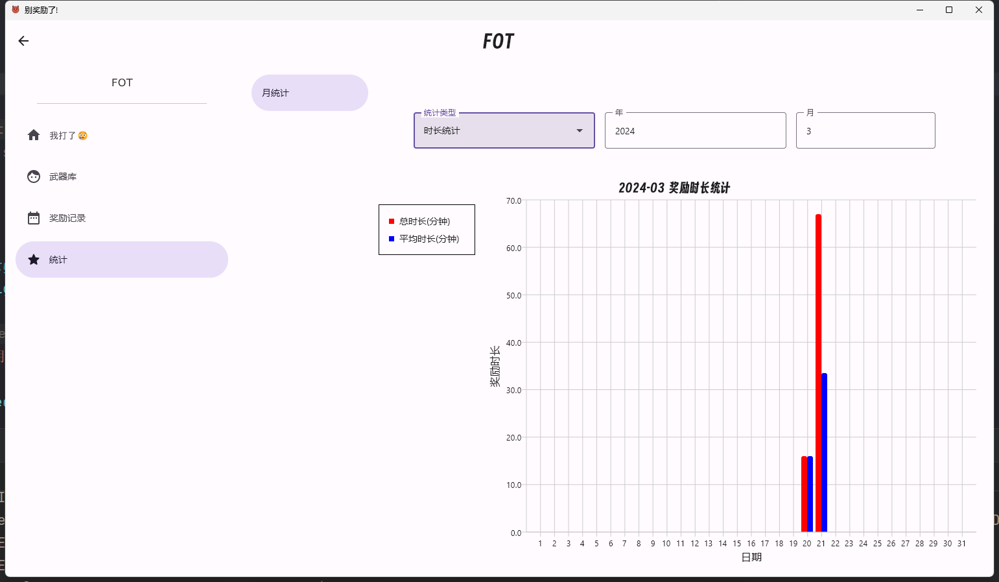

# 别奖励了😡

## 安装

### 下载安装包

前往 [下载页](https://fortescarlet.github.io/StopBonus/download) 下载安装包。

### 从 Release 下载

前往 [latest release](https://github.com/ForteScarlet/StopBonus/releases/latest) 自行选择并下载合适的安装包安装：

- `.zip` 格式的文件为解压**免安装**版本，对于 Windows 用户比较推荐这个类型，目前支持 Windows 系统的和 macOS 系统的。
- 其他的安装包格式请参考自己的系统选择适合的安装包使用。

### 从源码构建

自行拉取源代码后构建应用。

### 

## 使用

**数据保存位置**

Windows 默认使用 `%USERPROFILE%\AppData\Local\StopBonus\data`，
MacOS 和 Linux 通常使用 `~/StopBonus/data`。

SQLite 数据库文件为 `bonus.sqlite`。应用菜单中的「数据库 → 备份与恢复」可以创建和恢复完整备份。

**如何使用**

奖励完了填个表。

## 更新

从 H2 版本升级前，请退出旧应用和托盘。新版本会检查旧数据库。若旧版数据位于旧安装目录，可以在迁移页手动选择 `bonus.d.mv.db` 文件。

选择旧电脑保存记录时使用的系统时区。应用会保留 H2 原文件，在数据目录下的 `backups` 另存一份备份，并显示导入结果。确认后，新记录会保存到 SQLite。启用 SQLite 后请使用新版本，旧应用仍会写入原 H2，两个库的数据会分开。

恢复 SQLite 备份前，应用会在 `backups` 保留当前库。CSV 和 Excel 导出适合查看记录，完整恢复请使用 SQLite 备份。

当然，如果实际上是我配置的有问题请务必[告诉我](https://github.com/ForteScarlet/StopBonus/issues/new)，
非常感谢！

## 截图

